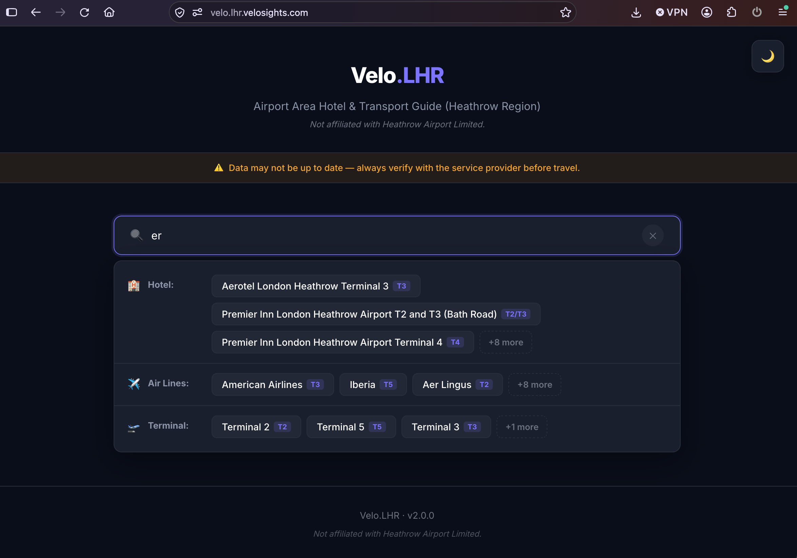
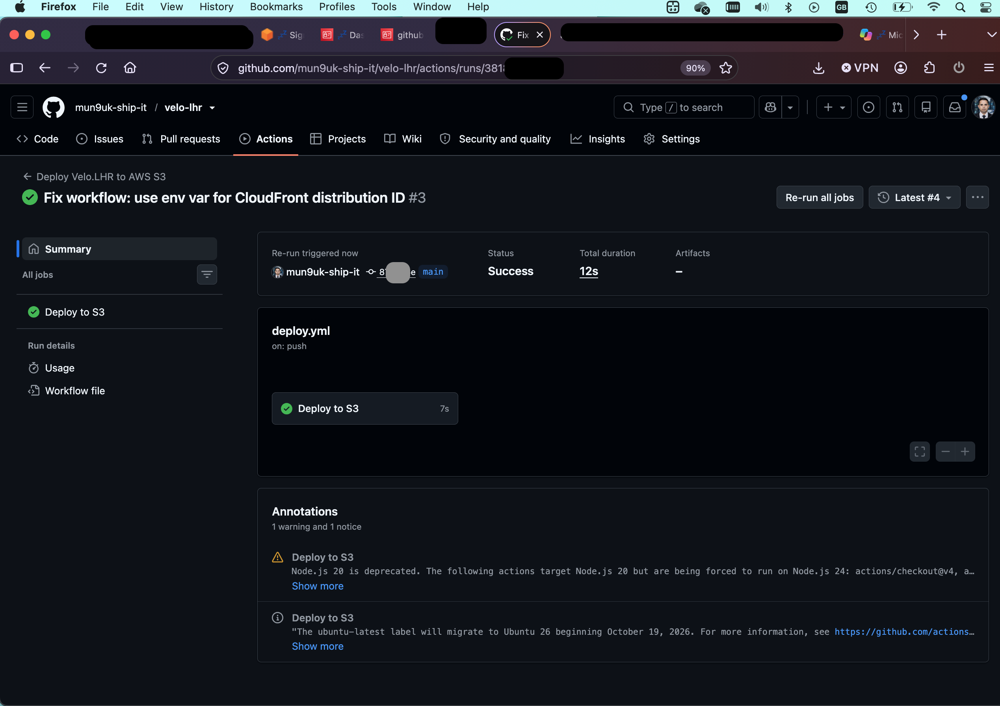
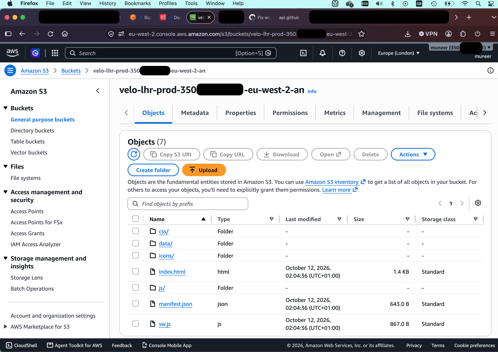

# ✈️ Velo.LHR — Serverless AWS PWA

> Airport Area Hotel & Transport Guide (Heathrow Region)

A live, production-ready Progressive Web App (PWA) that helps travellers find hotels, airlines, and transport options near Heathrow Airport. 

🔗 **[Live Demo](https://velo.lhr.velosights.com)**



## ⚠️ Disclaimer
**Velo.LHR is not affiliated with Heathrow Airport Limited.** "Heathrow" is used strictly as a geographic reference.

---

## ☁️ Cloud Architecture & DevOps (The Real Project)

This isn't just a frontend tutorial. It is a fully deployed cloud project using modern AWS practices.

*   **Hosting:** Amazon S3 (Static Web Hosting)
*   **CDN & HTTPS:** Amazon CloudFront + AWS Certificate Manager (ACM)
*   **Security:** AWS IAM with OpenID Connect (OIDC) — *Zero hardcoded passwords*.
*   **CI/CD:** GitHub Actions (Automated deployment and cache invalidation).
*   **Frontend:** Vanilla JS, Service Workers (Offline-first), IndexedDB.

---

## 🚧 Challenges Solved (The "Real" Engineering)

1. **Secure CI/CD (No Passwords):** I ditched long-term AWS Access Keys. Instead, I set up an IAM Identity Provider for GitHub and created a Trust Policy that allows GitHub Actions to assume a temporary role via OIDC.
2. **S3 Permissions:** Encountered an `AccessDenied` error during deployment. I resolved it by fine-tuning the IAM Policy to grant `s3:ListBucket` and `s3:PutObject` specifically to the `velo-lhr-prod` bucket.
3. **Cache Invalidation:** Configured the CI/CD pipeline to automatically run `aws cloudfront create-invalidation` after every deployment to ensure users always see the latest version.
4. **PWA Auto-Updates:** Built a custom version-checking mechanism using Service Workers and a `version.json` file. The app silently updates local IndexedDB data when a user reconnects.

---

## 📸 Project Showcase

### 1. Automated CI/CD Pipeline
*GitHub Actions successfully building, syncing to S3, and invalidating CloudFront.*


### 2. Serverless Hosting (S3 & CloudFront)
*Files synced to the S3 bucket, served globally via CloudFront.*


### 3. Secure HTTPS (AWS Certificate Manager)
*Custom domain secured with an Amazon Issued SSL Certificate.*


### 4. The Live Application
*The final PWA running on `https://velo.lhr.velosights.com`.*


---

## 📂 Project Structure

```text
velo.lhr/
├── .github/workflows/
│   └── deploy.yml          # AWS CI/CD Pipeline
├── public/
│   ├── data/               # JSON Database
│   ├── css/                # Styling
│   ├── js/                 # App logic & IndexedDB
│   ├── index.html
│   ├── manifest.json       # PWA config
│   └── sw.js               # Service Worker
├── scripts/
│   └── generate-version.js # Auto-update logic
├── docs/                   # AWS Architecture Screenshots
└── README.md
```


---

## 🚀 Local Development

1. Install dependencies:

```bash
npm install
```

2. Run locally:

```bash
npm start
```

3. Build version.json:

```bash
npm run build
```
---

## 📜 License

This project is licensed under the MIT License - see the [LICENSE](LICENSE) file for details.

---

## 🤝 Connect with Me

I'm currently open to opportunities in **Cloud Engineering**, **DevOps**, and **AI Systems**!

*   💼 **LinkedIn:** [Muneer Ahmed](https://www.linkedin.com/in/muneer-ahmed-it-cloud-ai-support)
*   🌐 **Live App:** [Velo.LHR](https://velo.lhr.velosights.com)
*   🐙 **GitHub:** [@mun9uk-ship-it](https://github.com/mun9uk-ship-it)

Feel free to reach out if you have any questions about the AWS architecture or the CI/CD pipeline!

